# Armá tu llavero OLED

Página para personalizar el llavero animado de la expo: elegís nombre, rol, curso y
una de 30 caras animadas, lo grabás por USB desde el navegador y descargás la
carcasa para imprimir, con tu nombre en la tapa.

**Usala acá:** https://popertoelpoperon.github.io/llavero-oled/

## Cómo se usa

1. Abrí la página en **Chrome o Edge** (Firefox y Safari no pueden grabar por USB).
2. Completá los pasos y mirá cómo queda.
3. Enchufá el llavero con un cable USB de datos, apretá RST y tocá **Grabar en el llavero**.
4. Descargá el STL (todas las piezas juntas o en partes separadas) e imprimilo.

> [!WARNING]
> **Modo descarga.** Si después de grabar la pantalla queda negra, el ESP32 quedó en
> modo descarga (el modo para programarlo): apretá **RST** una vez y arranca.
> Si la página no encuentra el llavero, ponelo en ese modo a mano: mantené **BOOT**,
> apretá y soltá **RST**, soltá **BOOT** y volvé a tocar *Grabar*. Al terminar, apretá **RST**.
> A batería el chip duerme y la compu no lo ve: grabalo siempre con el USB enchufado.

## Componentes

| Componente | Detalle |
|---|---|
| ESP32-C3 SuperMini | El microcontrolador, con USB-C |
| Pantalla OLED 0.96" SSD1306 | 128×64, I2C, bicolor (franja amarilla y zona celeste) |
| Cargador TP4056 con protección | Micro-USB |
| Batería LiPo de 1 celda (3,7 V) | Que entre en 44 × 11 × 6 mm |
| Carcasa impresa en PLA | Unos 25 g; las piezas salen de esta página |

## Conexiones

| Desde | Hasta |
|---|---|
| Pantalla VCC | ESP32 **3V3** |
| Pantalla GND | ESP32 **GND** |
| Pantalla SCL | ESP32 **GPIO6** |
| Pantalla SDA | ESP32 **GPIO5** |
| Batería + (rojo) | Cargador **B+** |
| Batería − (negro) | Cargador **B−** |
| Cargador **OUT+** | ESP32 **5V** (nunca a 3V3) |
| Cargador **OUT−** | ESP32 **GND** |

Antes de soldar, sacale los pines a la pantalla y al ESP32: con los pines puestos no entra.

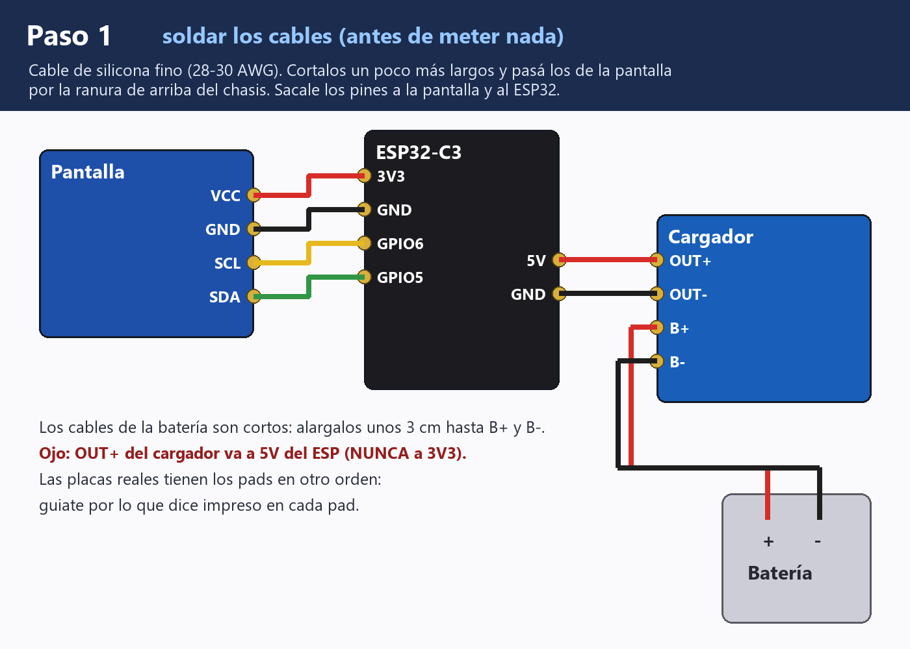

## Armado

De adelante hacia atrás, en este orden:

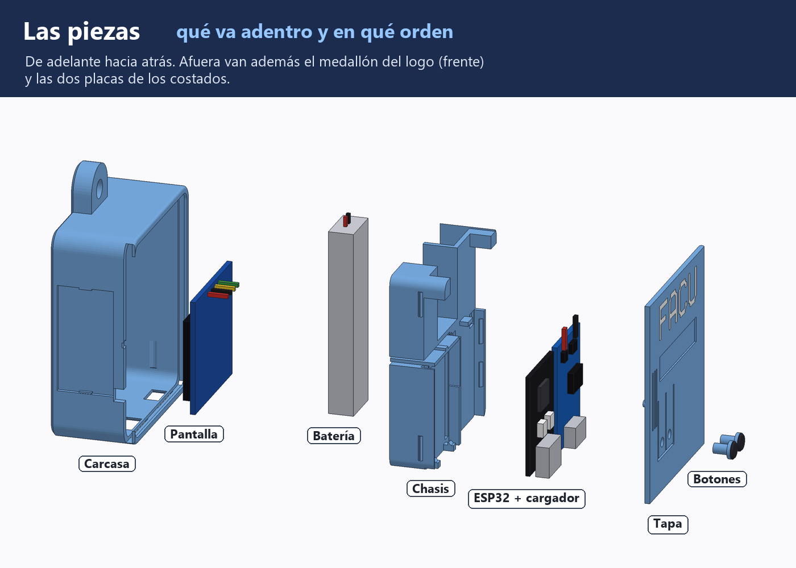
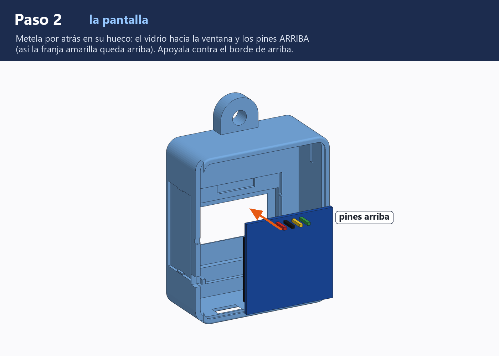
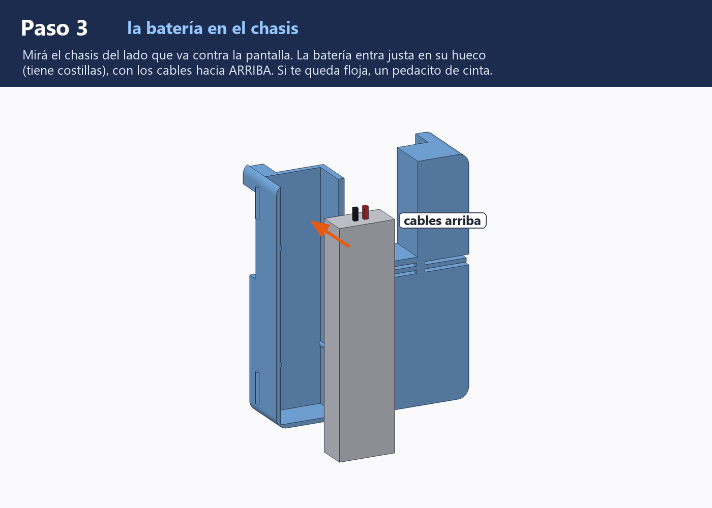
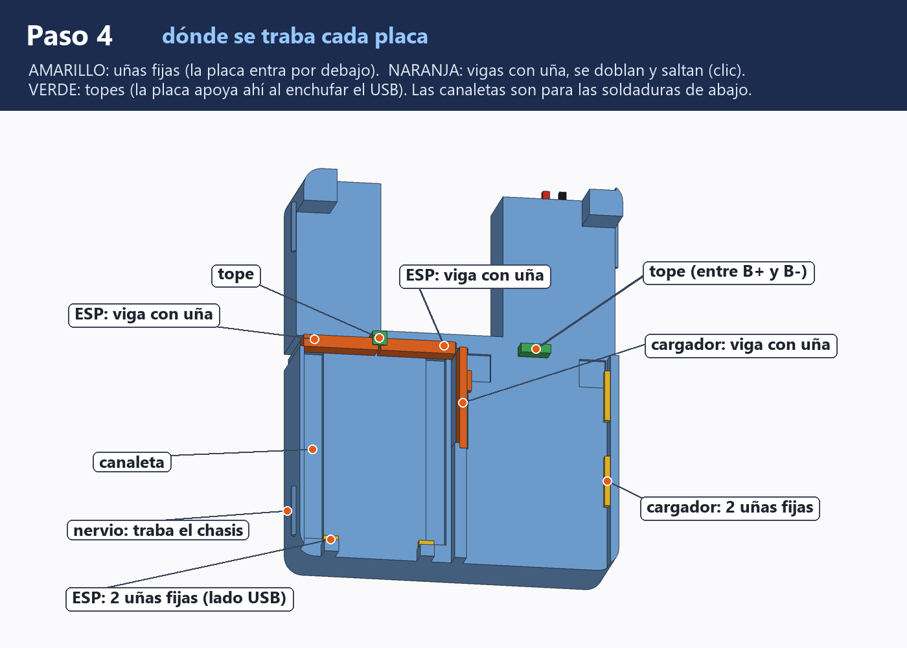
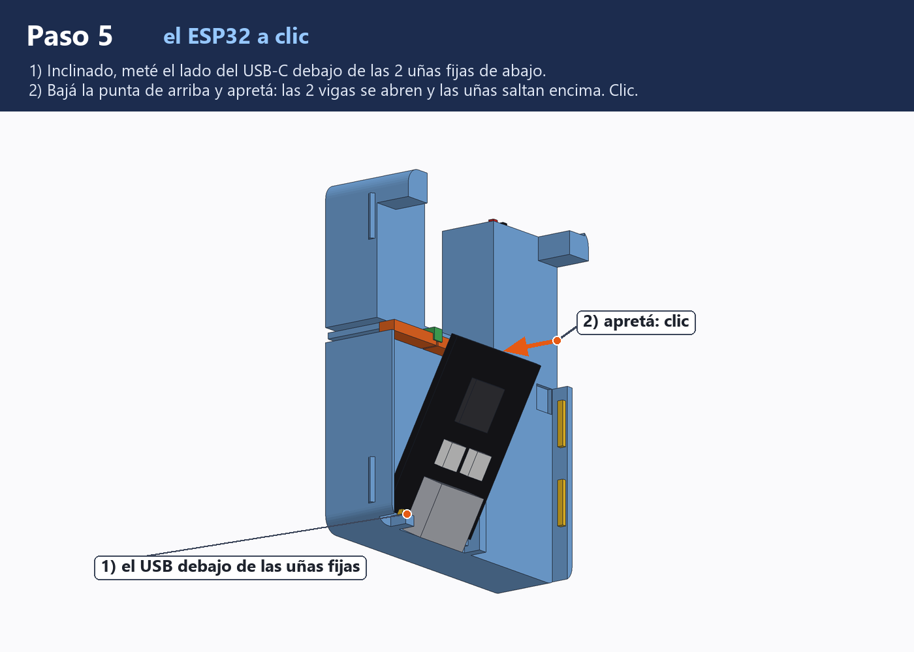
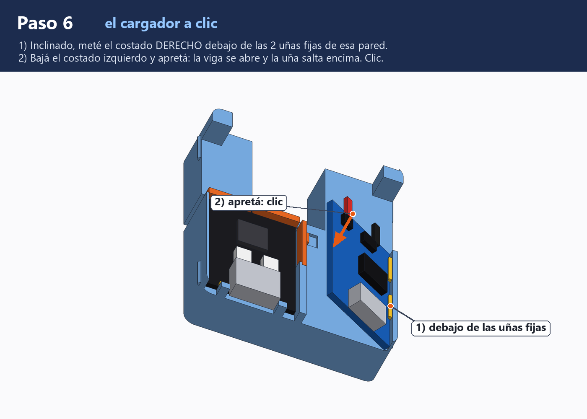
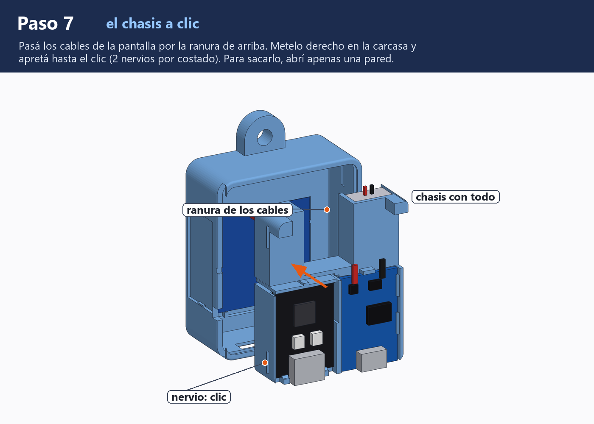
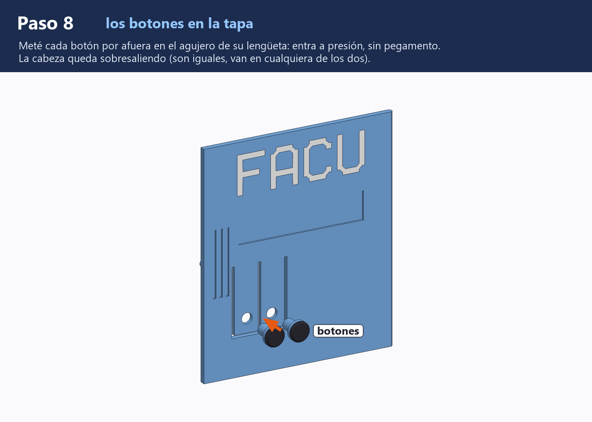
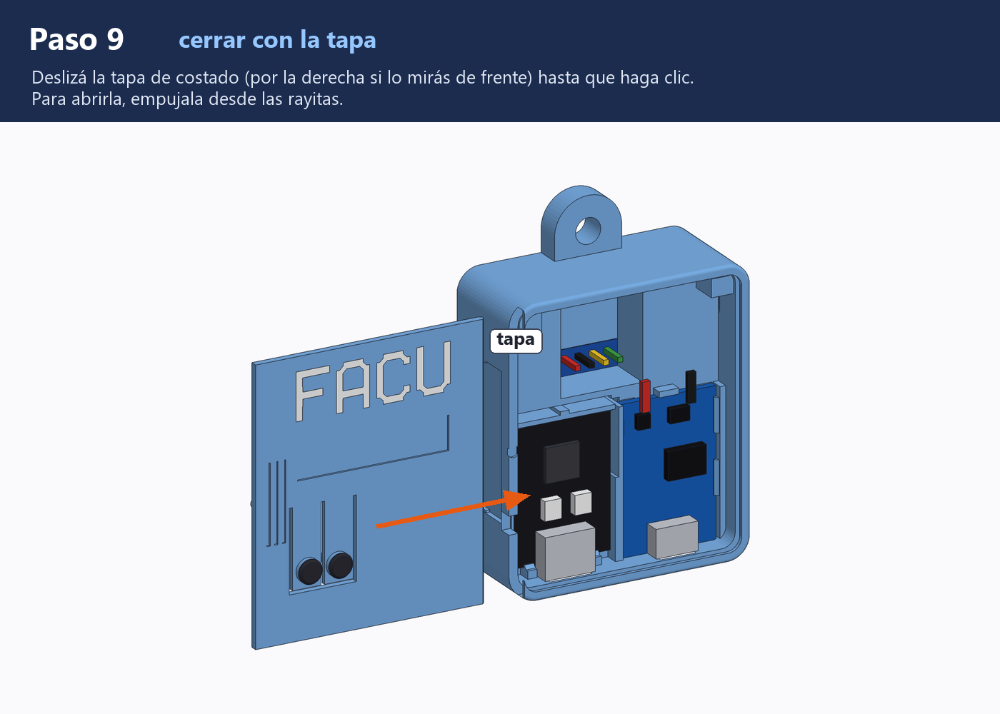
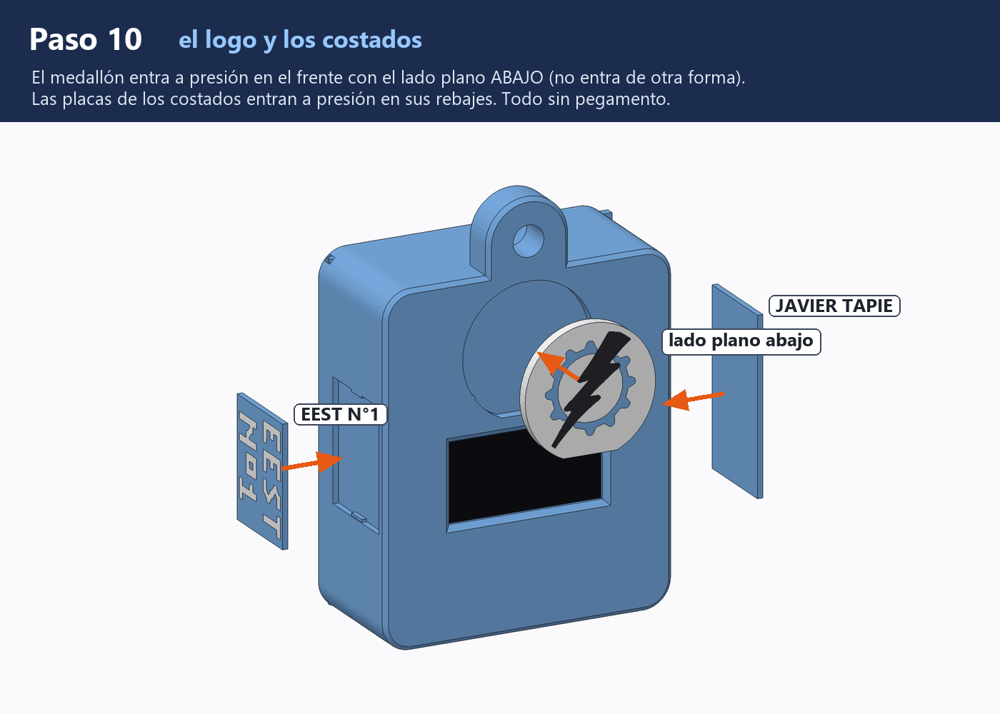
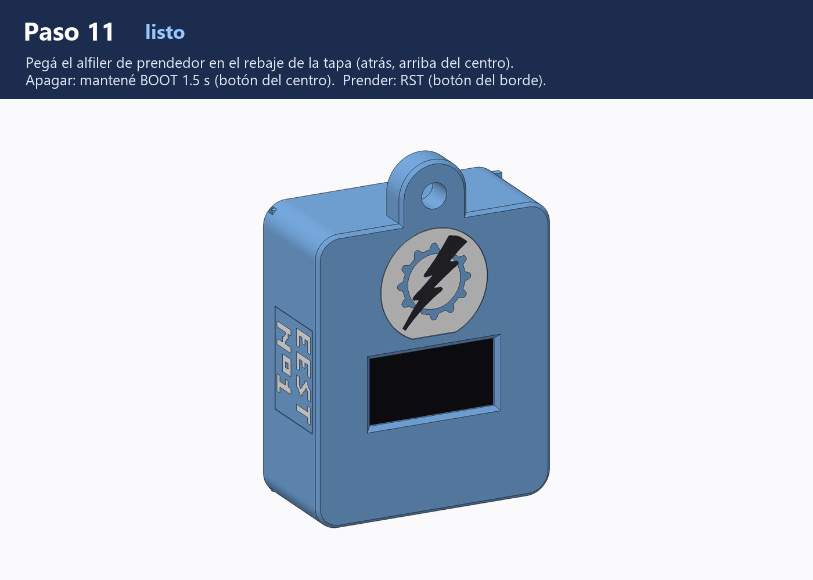
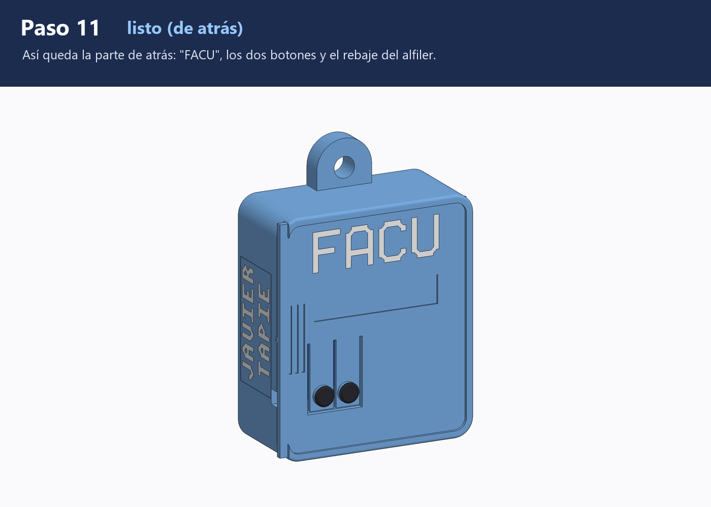

**Apagar:** mantené BOOT 1,5 s. **Prender:** apretá BOOT o RST.

## Qué hay acá

`index.html`, `estilos.css` y `js/` son la página; `datos/` tiene las caras, la letra
y el medallón; `firmware/` el programa ya compilado; `piezas/` los STL de la carcasa;
`armado/` las imágenes de esta guía, y `vendor/` las librerías y la tipografía, con su licencia.
